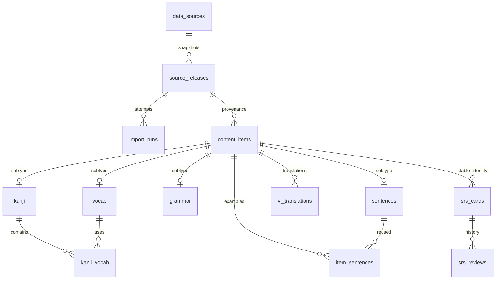

# Đặc tả nguồn dữ liệu Nihon Nihon

Trạng thái: **Frozen 0.2 — nền dữ liệu G0**, ngày 10/11/2026, sau nghiệm thu
N2–N5 **11/11 PASS** và CI xanh. Phạm vi chốt: câu, bản dịch, Hán Việt, nghĩa
từ/kanji/ngữ pháp và dữ liệu nét. Ba clip thật, font trên điện thoại thật và
shadowing **pending nghiệm thu G1**, không được đánh PASS.
Xem [bằng chứng, waiver và phạm vi Frozen](coverage-repair.md#frozen-g0-data-foundation).
Tệp SQL giữ tên `schema.draft.sql` để tương thích công cụ; không đổi cấu trúc schema.
Sau Frozen, mọi sửa text phải qua importer có provenance. Báo cáo/DB/raw vẫn riêng tư.

Đầu ra: [SQL nháp](schema.draft.sql), [bằng chứng khảo sát](source-audit.json),
[kiểm tra schema](../../tests/data/schema.test.cjs). SQL là hợp đồng trung lập ORM;
Drizzle/Prisma chưa cần quyết định ở mốc này. SQLite >= 3.38, bật foreign keys trên **mọi kết nối**.

## 1. Danh mục nguồn

### 1.1 Nguồn đã khảo sát bằng dữ liệu thật

Đã tải và đọc 15 file JSON OpenJLPT (3 loại × N5–N1), schema upstream, `NOTICE.md`
và `data/json/meta.json`. Pin tại commit `0d1d3410bec90bd4098a7c72de820543cb4f707c`,
version **0.3.0**. [Snapshot cố định](https://github.com/evanclan/OpenJLPT/tree/0d1d3410bec90bd4098a7c72de820543cb4f707c).
SHA-256 từng file và số bản ghi nằm trong `source-audit.json`; đó là hash byte tải về,
không phải hash JSON đã chuẩn hoá. Không commit bộ dữ liệu tải về.

| Loại | N5 | N4 | N3 | N2 | N1 | N5–N2 |
| --- | ---: | ---: | ---: | ---: | ---: | ---: |
| Từ vựng | 674 | 630 | 1.659 | 1.778 | 3.070 | 4.741 |
| Kanji | 84 | 169 | 387 | 398 | 1.345 | 1.038 |
| Ngữ pháp | 81 | 98 | 101 | 123 | 123 | 403 |

N5–N2 có **166 từ không có ví dụ** và **22 mặt chữ có nhiều cách đọc**. Danh sách
mặt chữ/cách đọc trong audit là kết quả đo, không lấy số liệu prototype. Không có
khoá từ/kanji/ngữ pháp trùng giữa các cấp trong snapshot đã đọc. Phạm vi nhập đầu
tiên: N5–N2; schema nhận N1 để không phải đổi enum khi mở rộng. Cấp JLPT là phân
loại của bộ dữ liệu, không được giới thiệu là danh sách chính thức của đơn vị tổ chức thi.

### 1.2 Registry nguồn, phiên bản và ghi công

`verified` dưới đây chỉ nói về mức khảo sát, không phải kết quả batch nhập database.
Nguồn chưa tải phải có version/checksum cụ thể trước khi dùng; không ghi ngày kiểm tra
trang web thành ngày import hay coi `latest` là phiên bản bất biến.

| source_id / nguồn | URL chính thức, định dạng và phạm vi | Giấy phép / cách ghi công | Pin ở bản nháp |
| --- | --- | --- | --- |
| `openjlpt` | [OpenJLPT](https://github.com/evanclan/OpenJLPT), JSON theo loại/cấp; nền từ, kanji, ngữ pháp | [CC BY-SA 4.0 và NOTICE](https://github.com/evanclan/OpenJLPT/blob/0d1d3410bec90bd4098a7c72de820543cb4f707c/NOTICE.md). Ghi OpenJLPT contributors và các nguồn upstream; đánh dấu phần đã chuyển đổi | **Verified**, 0.3.0 + commit ở trên; hash 15 file trong audit |
| `jmdict` | [EDRDG](https://www.edrdg.org/jmdict/j_jmdict.html), XML gzip; mở rộng cách viết/cách đọc, nghĩa và POS | [CC BY-SA 4.0 / EDRDG](https://www.edrdg.org/edrdg/licence.html); ghi James William Breen và EDRDG, link nguồn và giấy phép | `meta.json` OpenJLPT ghi created **2026-09-29**; chưa tải đúng artifact nên chưa có checksum |
| `kanjidic2` | [KANJIDIC2](https://www.edrdg.org/wiki/index.php/KANJIDIC_Project), XML gzip; âm đọc, nét, bộ thủ | CC BY-SA 4.0 / EDRDG như trên | Upstream meta: database_version **2026-272**, created **2026-09-29**; dữ liệu dẫn xuất đã có trong OpenJLPT, XML riêng chưa tải |
| `jmdict-furigana` | [Doublevil/JmdictFurigana](https://github.com/Doublevil/JmdictFurigana), JSON gzip; đoạn ruby theo cặp chữ/cách đọc, không phải tokenizer câu | [Repo LICENSE là MIT](https://github.com/Doublevil/JmdictFurigana/blob/master/LICENSE); giữ copyright Doublevil và MIT cho công cụ, đồng thời ghi EDRDG cho dữ liệu từ điển dẫn xuất. Không mặc định toàn bộ dữ liệu chỉ có MIT | Planned: chọn release phù hợp snapshot từ điển, lưu tag + SHA-256 artifact; chưa tải |
| `kradfile` | [KRADFILE](https://www.edrdg.org/krad/kradinf.html), văn bản EUC-JP; thành phần chữ, không thay thế radical Kangxi | CC BY-SA 4.0 / EDRDG; giữ credit tác giả trong header (KRADFILE2 có thêm Jim Rose) | Planned: pin URL, ngày/snapshot và checksum tệp; chưa tải |
| `kanjivg` | [KanjiVG](https://kanjivg.tagaini.net/), SVG/XML gzip; nét theo thứ tự và biến thể | CC BY-SA 3.0; ghi Ulrich Apel, KanjiVG, link giấy phép và ghi thay đổi nếu trích path | Planned: release tag/commit + checksum; chưa tải bộ đầy đủ. SVG prototype không được coi là dữ liệu toàn bộ |
| `kanjidictvn` | [KanjiDictVN](https://github.com/trungnt2910/KanjiDictVN), Yomitan `out_vn/kanji_bank_*.json`; tuple 6 phần tử, nhiều âm Hán Việt ở vị trí 1 | Code MIT, **âm đọc/nghĩa © hvdic.thivien.net** theo README. Không có bằng chứng dữ liệu được cấp MIT. Theo ràng buộc dự án chỉ dùng riêng, không phát hành lại | Planned/private_only: pin commit + hash sau khi lấy riêng; cấu trúc tuple được chủ dự án cung cấp, chưa tải/kiểm tra toàn bộ bank |
| `bunchaway-javi` | [tu-dien-nhat-viet](https://github.com/bunchaway/tu-dien-nhat-viet), `final.csv`; nghĩa từ, hai cột, thiếu cách đọc | README ghi CC BY-SA 4.0; credit Bunchaway, link repo/license, nêu chuẩn hoá và ghép nguồn | Planned: commit + hash CSV; chưa tải/đo lại số dòng. Con số 360.083 trong brief chưa được xác nhận ở snapshot này |
| `tatoeba` | [Downloads](https://tatoeba.org/en/downloads), TSV sentences/details/links; câu Nhật, Anh và bản dịch Việt có liên kết | [Text mặc định CC BY 2.0 FR](https://tatoeba.org/en/terms_of_use), có giấy phép theo câu; lưu ID, tác giả và license từng câu. Audio có thể khác license | Planned: ngày export + checksum mỗi tệp. ID câu Nhật trong OpenJLPT không phải ID bản dịch Anh/Việt |
| `unihan` | [Unihan / UAX #38](https://www.unicode.org/reports/tr38/), ZIP/TSV, `kVietnamese` để đối chiếu âm | [Unicode License v3](https://www.unicode.org/license.txt); giữ copyright Unicode và thông báo giấy phép | Planned: chọn version UCD cụ thể + checksum ZIP; chưa tải, không coi tài liệu UAX là artifact dữ liệu |
| `cvdict` | [ph0ngp/CVDICT](https://github.com/ph0ngp/CVDICT), `CVDICT.u8`; từ điển Trung–Việt dẫn xuất CC-CEDICT, giữ phồn thể/giản thể/pinyin | README xác nhận **CC BY-SA 4.0**, tác giả **Phong Phan**; ghi tác giả, link repo/license và nguồn CC-CEDICT. Pinyin không phải âm Hán Việt; nghĩa tiếng Trung không thay nghĩa tiếng Nhật | **Planned**: URL và license đã xác minh ngày 05/11/2026; pin commit/hash tệp trước import, chưa tải/đo coverage |
| `kanji-alive` | [kanji-data-media](https://github.com/kanjialive/kanji-data-media), CSV + audio từ ghép | CC BY 4.0 cho dữ liệu/media được nêu ở README; credit Kanji alive. Không áp license này cho các font ngoại lệ | Planned: commit + hash CSV/media được dùng; không giả định có audio cho mọi từ |
| `tts:<provider>` | TTS chưa chọn; audio sinh theo nội dung/cách đọc, cấu hình giọng | Theo điều khoản provider/model được chọn, **không tự gán CC BY**. Lưu provider/model/voice/config trong manifest | Chưa chọn; không gọi dịch vụ trong nhánh này |
| `mt:<provider>` | Dịch máy theo provider được chọn; đầu vào theo ngữ cảnh, đầu ra JSON/text tiếng Việt | Theo điều khoản provider/model; không tự gán giấy phép mở cho đầu ra. Attribution ghi provider/model, phiên bản prompt và nguồn văn bản đầu vào | Planned: đăng ký source_id thật khi chọn provider, mỗi cấu hình model + prompt_version là một release; không gọi dịch vụ ở nhánh này |
| `user-media` | Nguồn nội bộ được seed trong SQL; file cá nhân hoặc metadata YouTube do người học cung cấp, manifest JSON riêng | `private_only`; giữ quyền của chủ media, ghi nguồn/tác giả/URL gốc ở mỗi asset. Việc tạo clip không cấp lại quyền phân phối video | Local: mỗi clip mới hoặc lần sửa nội dung/mốc câu tạo release riêng có UUID/revision và hash manifest; không có upstream dataset để tải |

Jonathan Waller/Tanos được ghi như upstream của OpenJLPT qua NOTICE; không tải và
trộn lại lần nữa. Không gom mọi nguồn thành một giấy phép chung. Giao diện Nguồn dữ liệu
phải hiển thị tên, URL, snapshot, license, tác giả và biến đổi. Các câu Tatoeba cần
credit người đóng góp của chính câu đó, không chỉ một dòng “Tatoeba”.

Không dùng bản JMdict mới bất kỳ với snapshot OpenJLPT cũ: lấy được đúng bản upstream
hoặc dựng lại bộ tương thích và cập nhật manifest có kiểm thử; nếu không thì để bước
enrichment bị chặn, vẫn có thể dùng các trường JMdict đã nhúng trong OpenJLPT.

## 2. Map trường và chuyển đổi

Hợp đồng chung: decode đúng encoding → chuẩn hoá NFC → kiểm tra → map. Giữ ID nguồn
nguyên văn; không hash lại ID OpenJLPT từ word/reading. `source_hash` là SHA-256 của
JSON nội dung nguồn đã chuẩn hoá và serialize với thứ tự khoá ổn định (quy định serializer
ở importer); bỏ metadata thời gian/phiên bản để cập nhật snapshot không làm mọi bản dịch stale.

### 2.1 OpenJLPT

| Trường nguồn | Cột/quan hệ đích | Quy tắc |
| --- | --- | --- |
| vocab `id` | `content_items.source_key` | Khoá frozen upstream; `item_id = openjlpt:vocab:<id>` |
| `word`, `reading`, `romaji`, `level` | `vocab.word/reading/romaji/level` | Bắt buộc; không gộp theo word. Giữ kana gốc; không biến katakana thành hiragana ở cột gốc |
| `meanings[]`, `pos[]`, `jmdict_id` | `vocab.meanings_en`, `pos` (JSON), `jmdict_id` | Giữ thứ tự nghĩa; POS thiếu → `[]`; JMdict ID thiếu → NULL; không chọn sense đầu tiên khi enrichment |
| `other_forms[]`, `other_readings[]` | `vocab_forms` | Một hàng mỗi dạng và loại; không tự suy ra tích Descartes writing × reading hợp lệ |
| vocab/grammar `examples[].ja/en/furigana/tatoeba_id` | `sentences.text_ja/text_en/furigana_notation/tatoeba_ja_id`, `item_sentences` | Không bắt buộc ví dụ cho từ; giữ thứ tự position 0-based. Không chép annotation `{漢字|かな}` thành HTML tin cậy |
| kanji `character` | `kanji.character`, `source_key` | Kanji không có trường `id`; key = mã Unicode (`U+65E5`), item_id = `openjlpt:kanji:U+65E5`; không giả định JS length=1 |
| `level`, `strokes`, `grade`, `freq`, `radical`, `radical_number` | `kanji.level/strokes/grade/frequency_rank/radical/radical_number` | Giữ NULL upstream, không thay bằng 0; radical_number 1–214 |
| `onyomi[]`, `kunyomi[]`, `nanori[]`, `meanings[]`, `supplementary` | Các cột tương ứng của `kanji` | Giữ `.` và `-` trong âm Kun; nanori thiếu → []; supplementary thiếu → 0 |
| kanji `words[]` | `kanji_vocab` | Tìm mọi ID từ phù hợp mặt chữ trong phạm vi, không chọn một ID tuỳ ý; ghi số liên kết chưa giải được |
| grammar `id` | `source_key`, `item_id = openjlpt:grammar:<id>` | Giữ slug nguồn; khác namespace với từ |
| `pattern`, `reading?`, `romaji`, `level`, `meaning`, `formation`, `notes?`, `tags[]` | `grammar.pattern/reading/romaji/level/meaning_en/formation_en/notes_en/tags` | Giữ chuỗi formation gốc, không ép thành một công thức duy nhất; notes/reading thiếu → NULL |
| provenance upstream | `content_items.source_id/release_id/field_sources` | source_id chính = openjlpt; field_sources ghi nguồn từng nhóm trường và release/hash, ví dụ nghĩa từ từ OpenJLPT/Waller, POS từ JMdict |

Câu có Tatoeba ID dùng `tatoeba:sentence:<ja-id>`; câu nguyên gốc không ID dùng
`openjlpt:sentence:<sha256(NFC-ja)>`. Text Nhật trùng được dùng chung; nếu các nguồn
cho bản Anh khác nhau thì ghi provenance/candidate riêng trong staging, không âm thầm
ghi đè. Sửa text câu không ID tạo key mới và liên kết mới, giữ key cũ bất hoạt để
bản dịch/thẻ cũ vẫn truy được. Không dùng vị trí ví dụ làm ID.

### 2.2 Nguồn bổ trợ

| Nguồn / trường | Đích | Quy tắc, trường hợp không chắc |
| --- | --- | --- |
| JMdict XML `ent_seq`, `k_ele/keb`, `r_ele/reb`, `re_restr`, sense `stagk/stagr/pos/gloss` | `vocab.jmdict_id`, `vocab_forms`; staging sense-aware | Ghép entry ID, sau đó áp hạn chế reading/writing/sense; giữ raw XML riêng. Bản nháp chỉ giữ tập liên quan các từ đã nhập, chưa chép toàn bộ ~200k entry |
| JmdictFurigana `text`, `reading`, `furigana[].ruby/rt?` | `word_furigana.word/reading/segments` | Khớp cặp, giữ segment liền cụm như 大人; nối ruby phải bằng word. Muốn furigana câu phải tokenize trước; không chia kana theo từng kanji bằng suy đoán |
| KRADFILE ký tự và danh sách thành phần | `kanji_components` | EUC-JP → UTF-8, bỏ dòng comment, bộ phận ≠ bộ thủ Kangxi |
| KanjiVG tên mã ký tự/variant, `path` theo stroke group | `kanji_strokes.kanji_id/variant/stroke_no/path_d` | stroke_no 1-based; chọn bản chuẩn trước, giữ variant riêng; không coi text số thứ tự là nét. Tắt external entities khi parse XML, không phục vụ script/SVG chưa làm sạch |
| KanjiDictVN tuple `[character, han_viet_space_separated, "", "", meanings[], stats]` | `vi_translations` field `han_viet`, method `han_viet` | Vị trí **1** là chuỗi âm Hán Việt, **không phải onyomi**; vị trí 2/3 rỗng, vị trí 4 là nghĩa có nhãn âm `[âm]`, vị trí 5 là thống kê. Không map theo tên trường của bank tiếng Anh. Tách nhiều âm thành candidate như mục 5.2; không dùng nghĩa Hán Nôm thay nghĩa Nhật của 働 |
| Bunchaway CSV cột từ / nghĩa (vị trí 0/1) | `vi_translations.text_vi`, field `meaning`, method `dictionary` | Xác nhận header/quoting/dấu xuống dòng trên CSV thật; không split bằng dấu phẩy. Lưu key dòng hoặc hash dòng làm source_record_key; không tự tạo cột reading không tồn tại |
| Tatoeba sentence ID/lang/text/author/license và links | `sentences`, `vi_translations` field `text`, method `tatoeba` | Ghép link Nhật → Việt trực tiếp; nếu đi qua Anh chỉ là candidate cần kiểm tra. Lưu ID Việt, tác giả, link Nhật và license trong context_json |
| Unihan `U+…`, `kVietnamese`, value | `vi_translations` field `han_viet` | Giữ nhiều âm trong candidate, NFC; không coi trường thiếu là âm rỗng đã được xác nhận |
| Kanji alive CSV/example identity + file audio | `media_assets` | Khớp từ và cách đọc qua metadata, không dựa riêng filename hoặc mặt chữ |
| TTS text, reading, provider, model, voice | `media_assets` + source release manifest | Cache key gồm hash nội dung, giọng và model; không ghi token/API key; âm sinh không phải bản thu người bản xứ |
| MT provider, model revision, prompt_version, prompt hash, cấu hình | `data_sources` với `mt:<provider>`, `source_releases.manifest_json`, `vi_translations` | Release chụp cấu hình tái hiện; context_json của từng bản dịch giữ input hash, request context và nguồn nền. Không dùng OpenJLPT làm source_id của bản dịch máy |
| Clip cá nhân: UUID, loại file/YouTube, mốc cắt, phụ đề | `content_items(kind='clip',source_id='user-media')`, `source_releases`, `media_assets`, `clip_segments` | item_id `user-media:clip:<uuid>` giữ nguyên qua các revision; source_key=UUID. Câu phụ đề tự tạo dùng kind=sentence cùng nguồn và key độc lập; asset và segment cùng tham chiếu release hợp lệ |
| CVDICT: chữ phồn thể/giản thể, pinyin, nghĩa Việt | Candidate đối chiếu trong staging, chỉ sang `vi_translations` khi đã xác minh đúng trường/ngữ cảnh | Khảo sát cú pháp `CVDICT.u8` ở batch; giữ hai dạng chữ và nguồn dòng. Không suy âm Hán Việt từ pinyin và không tự selected nghĩa Trung cho từ/kanji Nhật |

CVDICT đã xác minh repo và license, ở trạng thái Planned cùng các nguồn chưa pin.
Khảo sát parser và giá trị đối chiếu trong batch trước khi bật enrichment tự động;
trạng thái Planned không có nghĩa là đã đo độ phủ hoặc đã import dữ liệu.

## 3. Schema, khoá và quan hệ

SQL thực thi được ở [schema.draft.sql](schema.draft.sql), gồm **20 bảng**. Mỗi bảng
khai báo PK/FK/CHECK/UNIQUE; bảng liên kết có PK ghép. Sơ đồ dưới là luồng chính,
SQL là nguồn chi tiết kiểu dữ liệu và ràng buộc.

| Bảng / PK | Quan hệ và nội dung |
| --- | --- |
| `data_sources(source_id)` | Registry: name, URL, license, version/imported_at/checksum lần thành công gần nhất, attribution, usage_scope. Chưa import → version/checksum/imported_at NULL, không bịa giá trị |
| `source_releases(release_id)` | FK source_id; snapshot bất biến có version, SHA-256, artifact URL, retrieved_at, license, attribution, manifest_json (object). UNIQUE(source_id,version,checksum); release có thể ứng với một tệp nguồn, revision clip hoặc cấu hình model/prompt |
| `import_runs(run_id)` | FK ghép (source_id,release_id); thời gian/trạng thái/report; một nguồn có nhiều lần chạy cùng artifact |
| `content_items(item_id)` | FK snapshot; UNIQUE(source_id,kind,source_key), hash nội dung, active, field_sources JSON. Identity dùng chung cho dịch/SRS, không trỏ vào text hiển thị |
| `vocab(item_id)` | FK ghép item_id/kind đảm bảo đúng subtype; từ, cách đọc, cấp, nghĩa Anh, POS, JMdict ID |
| `vocab_forms(item_id,form_kind,form)` | FK vocab và snapshot; nhiều cách viết/cách đọc, không giả định mọi tổ hợp đều dùng được |
| `kanji(item_id)` | FK subtype; character UNIQUE; nullable dữ liệu thiếu, mảng âm và nghĩa, supplementary |
| `grammar(item_id)` | FK subtype; mẫu, cách đọc, nghĩa/cấu trúc/ghi chú Anh, tags |
| `sentences(item_id)` | FK subtype; câu Nhật/Anh, furigana, Tatoeba ID unique nullable, attribution cấp câu |
| `item_sentences(item_id,sentence_id)` | FK content và sentences; UNIQUE(item_id,position), FK snapshot, thứ tự ví dụ |
| `kanji_vocab(kanji_id,vocab_id)` | Hai FK subtype và snapshot; quan hệ nhiều–nhiều |
| `word_furigana(word,reading,source_id)` | FK snapshot; cache tra ruby theo cặp cho cả từ ngoài danh mục JLPT, nên không ép FK vào vocab |
| `kanji_components(kanji_id,component,source_id)` | FK kanji và snapshot; nguồn decomposition có thể khác nguồn kanji |
| `kanji_strokes(kanji_id,variant,stroke_no)` | FK kanji/snapshot; d path, giữ thứ tự và variant; không chứa nội dung KanjiDictVN |
| `vi_translations(translation_id)` | FK content/snapshot; field, tiếng Việt, method, source_record_key, base_content_hash, status, needs_refresh, context_json, created_at. Unique identity candidate; tối đa một selected cho mỗi item/field |
| `translation_reports(report_id)` | FK translation; Báo sai với reason, thời gian, trạng thái; không cho người học biên tập nội dung nguồn |
| `media_assets(asset_id)` | FK content/snapshot; storage_ref, loại audio/video/tts, attribution/license riêng, private_only. Chỉ lưu metadata, không blob video/ghi âm trong Git |
| `clip_segments(clip_id,position)` | FK subtype clip, sentence và snapshot; thời gian ms với end > start; kiểm tra vượt độ dài/đè nhau thuộc importer |
| `srs_cards(card_id)` | FK content ON DELETE RESTRICT; UNIQUE(item_id,card_type), scheduler_version, state_json, due_at, updated_at. Loại `shadow` gắn item câu: nghe câu rồi nói lại/ghi âm; khác `listening` chỉ luyện nghe |
| `srs_reviews(review_id)` | FK card ON DELETE RESTRICT; rating 1–4, thời gian, phiên bản scheduler, elapsed_ms nullable |

Các bảng import có source_id và release_id FK ghép để không gắn nhầm release của nguồn
khác. `field_sources` có dạng `{"pos":{"source_id":"jmdict","version":"2026-09-29",
"via_release_id":"openjlpt-v0.3.0-vocab-n5"}}`; provenance nhúng upstream có thể chỉ biết
version, không giả mạo đã tải artifact upstream. Importer kiểm tra các source_id có trong registry,
release_id nếu có phải tồn tại; SQL không thể tạo FK tới từng khoá JSON.

Sự kiện/tiến độ người học (`srs_cards`, `srs_reviews`, `translation_reports`) không
phải nội dung nguồn nên không nhận source_id giả. **Nội dung do người học đưa vào**
(clip, câu phụ đề) có provenance thật là `user-media`, vẫn bắt buộc FK source/release.
Không nới release_id thành NULL cho clip. Schema một người dùng; authentication,
lộ trình, phiên học, bài thi và tokenizer đầy đủ thuộc g1, không dựng trước trong G0.

Các quyết định Draft: SQLite, ID có namespace, bảng dịch riêng, soft-delete nguồn,
chỉ giữ tập JMdict liên quan trước. Chưa chọn ORM, provider dịch máy/TTS, chưa chốt
bảng SRS state thành các cột FSRS; cần g1/srs quyết định version và migration sau batch.

### 3.1 Release của clip cá nhân và dịch máy

SQL seed duy nhất registry `user-media`, không seed release/clip giả. Khi tạo clip,
g1/shadowing tạo release và nội dung trong một transaction. Manifest chứa clip_uuid,
revision, origin_kind (`file` hoặc `youtube`), source file SHA-256 hoặc YouTube video ID,
URL gốc không có token, mốc cắt ms, subtitle hash, nguồn/tác giả/quyền media. Checksum
release là SHA-256 manifest chuẩn hoá, không giả làm hash bytes YouTube. artifact_url
trỏ manifest riêng `local://clips/<uuid>/<revision>/manifest.json`; retrieved_at là lúc
tiếp nhận nội dung. Sửa clip tạo release mới; giữ clip/item câu đã có UUID để không mất SRS.
Thêm/xoá câu giữ identity câu cũ; không dùng position hoặc timestamp làm ID câu.
Video cá nhân nằm storage riêng; YouTube chỉ lưu/embed theo nguồn, không mặc định tải video.

`shadow` là thẻ theo **câu** (`sentences.item_id`) liên kết qua clip_segments đến clip;
state/log scheduler theo srs_cards/srs_reviews. Tệp ghi âm và phiên luyện cụ thể thuộc
g1/shadowing; loại thẻ này không tự ghi rating từ điểm pitch chưa có.

Khi chọn MT, đăng ký `mt:<provider>` với URL/điều khoản thật. Mỗi bộ model revision,
prompt_version, SHA-256 prompt template và generation config có release bất biến;
đổi model hoặc prompt tạo release mới. manifest_json lưu các giá trị đó, checksum là
hash manifest (không phải hash mỗi câu dịch). artifact_url trỏ cấu hình nội bộ không
chứa secrets; context_json của bản dịch lưu input/base_content_hash và nguồn nội dung.
Provider chưa chọn vẫn là Planned, không tạo bản ghi literal `mt:<provider>`.

## 4. Quy trình import và cập nhật

1. **Chốt manifest.** Chọn commit/tag/export và danh sách tệp; registry đủ license,
   usage_scope, attribution. Nguồn unverified không được dùng; nguồn private_only chỉ
   vào máy riêng. Chọn snapshot JMdict tương thích như mục 1, không theo latest ngầm.
2. **Tải vào vùng riêng.** Lưu bytes gốc, URL cuối, thời gian UTC ISO-8601, SHA-256;
   checksum theo bytes trước giải nén. Kiểm tra hash upstream nếu có. Mỗi artifact
   có source_release bất biến; bundle ghi cả hash manifest và hash từng file.
3. **Parse staging.** JSON theo schema upstream; XML tắt external entities; CSV parser
   có quote/newline; EUC-JP decode tường minh. Không chạy code từ dữ liệu. Không ghi
   trực tiếp bảng đang phục vụ. Giữ raw riêng để truy vết nhưng không commit.
4. **Làm sạch.** NFC mọi text Nhật/Việt; giữ whitespace có nghĩa, không NFKC toàn bộ
   chữ Nhật, không viết lại ID, không xoá dấu tiếng Việt trong giá trị gốc. Chỉ key tìm
   kiếm được phép bỏ dấu. Bất kỳ text Việt còn khác NFC sau bước này → fail batch.
5. **Loại trùng.** Identity upstream trước, không theo word. Cùng source_key nội dung
   khác nhau trong một batch → lỗi. Dạng viết/link/component dedup bằng PK ghép;
   không gộp 方/かた với 方/ほう hoặc hai grammar có sắc thái khác nhau.
6. **Map và enrichment.** Áp mục 2 và chính sách Việt mục 5. Giá trị thiếu là NULL/[]
   đúng loại, không tự bịa ví dụ/âm/meaning. Giữ mọi candidate và lý do chưa khớp.
7. **Kiểm tra trước commit.** Schema/enum/ID/FK, counts theo manifest, NULL bắt buộc,
   thứ tự ví dụ/nét, chuỗi ruby khớp câu, ID nguồn trong field_sources, mọi nội dung
   xuất bản có attribution, danh sách thiếu dịch/nét, collisions và orphan links.
8. **Giao dịch áp dụng.** Backup SQLite qua API backup/consistent snapshot, gồm WAL
   đúng cách; không copy riêng file DB lúc đang ghi. Trong một transaction: UPSERT
   theo identity, cập nhật trường nguồn, append candidate dịch mới, đánh dấu needs_refresh
   nếu hash nội dung nền đổi. Tuyệt đối không `INSERT OR REPLACE`, TRUNCATE, xoá rồi
   insert content, hay cập nhật SRS trong importer. Lỗi bất kỳ → rollback.
9. **Nguồn bị xoá.** Set is_active=0, giữ item, bản dịch, card, reviews. Item ngừng dùng
   không được cấp thẻ mới; quyết định ôn thẻ cũ ở g1/srs. Chỉ deactivate sau khi snapshot
   đầy đủ đã validated, không khi import một file cấp/batch con.
10. **Cập nhật tháng.** Mỗi tháng kiểm tra nguồn mới; checksum không đổi → no-op. Có
    thay đổi → staging/diff/test/transaction như trên, cập nhật data_sources chỉ khi
    commit thành công; giữ release lịch sử. Tải lỗi hoặc nguồn thiếu bất thường giữ
    DB cũ; nếu chưa có snapshot so sánh thì batch đầu tạo baseline thay vì đặt ngưỡng tuỳ tiện.

Chạy lại cùng artifact: số item, selected translation, card, review không đổi.
Timestamp run có thể khác. Snapshot khác nhưng nội dung item không đổi: không làm
translation needs_refresh. Đổi nghĩa/cách đọc: giữ bản dịch cũ và SRS, gắn cờ dịch,
ghi diff; tách/gộp ID upstream cần migration mapping được duyệt, không tự nối theo mặt chữ.

Batch tiếp theo: 100 từ (80 N5 + 20 N2), 50 kanji, 20 grammar, 3 clip theo
`docs/features/g0-data-import.md` ở nhánh đó; bắt buộc phủ các tình huống thiếu ví dụ,
kana-only, katakana, する, nhiều cách đọc/cách viết, 働, KanjiVG variant. Đây là
**kế hoạch**, chưa chạy batch này trong nhánh data-spec. Báo cáo phải ghi actual counts,
coverage nghĩa Việt/Hán Việt/nét/câu dịch, precision ghép nghĩa, NFC, unresolved items,
before/after SRS và translation hashes, thử thất bại/rollback và chạy lần hai.
Riêng Hán Việt phải có số kanji đa âm trước/sau gộp alias, số có âm chính hợp lệ
và tỉ lệ trên toàn cohort manifest. Điều kiện bắt buộc là **100% kanji có đúng một
âm chính có căn cứ**, không làm tròn, không bỏ chữ thiếu khỏi mẫu số; xem HV-1.

Chỉ chuyển Draft → Frozen khi batch có bằng chứng đạt tiêu chí của nhánh import,
các điểm thiếu đã xử lý và SQL/mapping được sửa theo báo cáo. Nguồn chưa dùng có
thể giữ Planned; không được ghi “đã xác minh” cho phần chưa khảo sát.

## 5. Lớp nội dung tiếng Việt

### 5.1 Bản dịch độc lập và truy vết

Mỗi candidate là hàng `vi_translations`, FK thật tới content. `field` phân biệt meaning,
formation, notes, text câu và han_viet; không ghi text Việt vào `meanings_en` hoặc
thay đổi source payload. `source_record_key` truy lại dòng từ điển/ID câu; context_json
lưu reading dùng để khớp, sense nếu có, path ghép, tác giả/license câu, model/prompt_version
khi dịch máy, và các source release liên quan. Bản dịch ghép nhiều nguồn phải nêu rõ
mọi nguồn trong context, không chỉ tên mô hình cuối cùng.

`base_content_hash` chụp phiên bản nội dung nền lúc dịch. Nguồn thay đổi: giữ nguyên
text_vi và translation_id, set needs_refresh=1 nếu nội dung nền đổi; sinh candidate mới
với ID mới sau khi cần dịch lại. Chuyển selected trong transaction để giữ tối đa một
bản/field; không xoá bản cũ. Người học thấy bản Anh cùng bản Việt, nhãn dịch máy khi
áp dụng, nguồn và nút Báo sai; report liên kết đúng translation_id. Không tự biến Báo sai
thành quyền biên tập dữ liệu của người học.

### 5.2 Ghép nghĩa từ và Hán Việt

1. Tra từ điển theo `(word,reading)` nếu nguồn có reading; với CSV không reading, tra
   word nhưng kiểm tra ambiguity trước. Một mặt chữ nhiều reading trong danh mục thì
   không tự selected bằng word-only, kể cả CSV chỉ có một dòng nghĩa.
2. Nếu chưa khớp, tìm dạng viết JMdict hợp lệ với reading/sense đó (có re_restr/stagr/stagk).
   Không gộp mọi nghĩa chỉ vì chung JMdict entry. Chỉ-kana có thể có nghĩa ở dạng kanji;
   số 363 trong brief cần đo lại trên batch, không được coi là coverage đã đạt.
3. Trường hợp 22 mặt chữ nhiều reading đã đo, thiếu nghĩa, hoặc mapping không chắc:
   giữ candidate/needs_review và dịch máy theo **reading + nghĩa Anh + POS + ví dụ**,
   không đưa nghĩa dictionary mơ hồ lên thành selected tự động.
4. KanjiDictVN: kiểm tra tuple 6 phần tử; lấy character ở [0], âm ở [1],
   nghĩa có nhãn âm ở [4], thống kê ở [5]. NFC, lowercase, tách whitespace và dedup,
   rồi gộp alias chính tả/phương ngữ theo [HV-1](han-viet-policy.md): nhựt→nhật,
   nhơn→nhân, sanh→sinh, tí→tý. Chỉ gộp cặp được khai báo, không bỏ dấu toàn bộ.
   Không suy âm từ [2]/[3] hoặc nghĩa [4]. Tạo một candidate cho mỗi nhóm canonical;
   source_record_key gồm codepoint/âm canonical trong source release, context_json
   giữ chuỗi âm, bank/row/nhãn âm gốc và alias version. Chọn đúng một selected
   theo HV-1.2: một âm sau gộp → CVDICT compound evidence → Unihan khi có → AI.
   Mỗi lựa chọn ghi selection_method; AI là nguồn mt:<provider> có căn cứ, nhãn
   “tự chọn” và Báo sai, không cần người duyệt. Âm luôn nằm trong candidate của chữ;
   giữ các âm còn lại. Output AI lỗi/ngoài danh sách → retry hữu hạn, chưa đạt thì fail.
5. Kanji: nghĩa Việt dịch theo nghĩa Nhật/Anh OpenJLPT; âm Hán Việt lấy riêng từ
   KanjiDictVN riêng tư khi quyền dùng đã rõ, rồi đối chiếu Unihan. Không lấy nghĩa
   chữ Hán cổ làm nghĩa Nhật. Thiếu nguồn có quyền dùng → đánh dấu thiếu, không bịa âm.
6. Từ đọc âm On: chỉ ghép Hán Việt khi từng thành phần/reading đã xác nhận phù hợp.
   Âm On/Kun không được quyết định chỉ bằng regex hay loại chữ; từ đọc Kun, ateji,
   jukujikun hoặc không chắc để han_viet chưa có selected. Giữ provenance của từng âm
   trong context_json. Không làm mất nghĩa từ khi không ghép được Hán Việt.

CVDICT có thể cung cấp căn cứ từ ghép theo HV-1.2 nếu phân giải được âm Hán Việt
của chữ trong từ ghép tiếng Nhật phù hợp. Pinyin không phải Hán Việt; chỉ match mặt
chữ hoặc nghĩa tiếng Trung không đủ. Không dùng nghĩa Trung thay nghĩa Nhật.

### 5.3 Câu dịch, ưu tiên và dịch máy

Câu Việt có link trực tiếp Tatoeba và license/tác giả đầy đủ ưu tiên hơn dịch máy;
không suy ra quan hệ dịch chỉ vì hai câu gần giống. Nghĩa từ khớp reading/sense được
xác nhận ưu tiên hơn candidate word-only. Hán Việt không phải nghĩa tiếng Việt.
Không ghi đè selected đã được xác nhận bằng kết quả dịch máy mới chỉ vì model mới hơn.

Chỉ dịch phần thiếu một lần cho cache key `(item_id,field,base_content_hash,mt_release_id)`;
release đã khoá provider/model/prompt/config, tránh đụng cache giữa hai provider.
Chạy lại giữ kết quả đã lưu. Provider chưa chọn, chưa phát sinh
chi phí trong nhánh này. Không gửi credentials, bản ghi âm hay nội dung cá nhân vào
dịch vụ chỉ để dịch bộ từ công khai. Dịch máy lưu method=machine và context đủ để
tái hiện; nghĩa/câu dịch giữ candidate cho đến khi qua kiểm tra chất lượng, luôn
hiển thị nguồn Anh. Riêng chọn âm Hán Việt theo HV-1.2 cho phép AI selected sau
kiểm tra tự động membership/cấu trúc/căn cứ, có nhãn “tự chọn” và Báo sai; không cần
người duyệt. Lựa chọn AI là một hàng nguồn MT riêng, giữ candidates dictionary gốc.

### 5.4 Giới hạn phát hành và tiêu chí mốc

Registry/code/schema/tài liệu có thể nằm repo công khai; raw/downloaded database,
KanjiDictVN, video, bản ghi âm và cache dịch riêng ở thư mục bị ignore. `private_only`
không phải giấy phép do dự án cấp lại; không xuất hàng restricted sang gói dữ liệu công
khai. Nếu bản dịch dựa trên dữ liệu restricted, giữ cờ nguồn liên quan để không làm
mất hạn chế đó khi export. `.gitignore` chỉ là lớp bảo vệ Git, không thay quyền truy cập máy chủ.

Mốc yêu cầu lần này:

- [x] Có đủ 5 phần ở tài liệu này, phân biệt số đo thật và việc chưa làm.
- [x] Có SQL nháp với PK/FK, bảng data_sources, dịch độc lập và identity SRS.
- [x] Có kiểm tra tạo schema, ràng buộc và bảo toàn bản dịch/SRS trong transaction mẫu.
- [x] Nghiệm thu nền dữ liệu N2–N5 11/11 và Frozen; media/thiết bị/shadowing pending G1.
